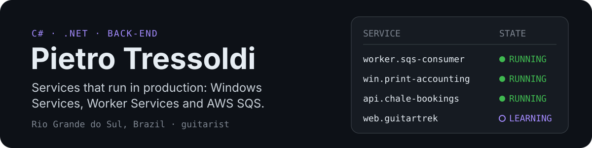

  

I'm a C# / .NET developer from Rio Grande do Sul, Brazil. At **DocService IT Solutions** I build and maintain back-end services that run in production: Windows Services and Worker Services in .NET Framework and .NET 6–10, AWS SQS consumers, the Windows Forms tools that configure them and the Advanced Installer packages that ship them.

Outside work I learn by building real things, like the booking API my family's chalet runs on. I'm in my 3rd year of a technical degree in Computer Science at IFRS, and I play guitar.

### Featured

- **[Chalé Alto do Morro API](https://github.com/PietroTressoldi/ChaleAltoDoMorroAPI)**: ASP.NET Core booking API in daily use, handling pre-reservations, the calendar and the cash book. .NET 10 · PostgreSQL · JWT · Docker.
- **[GuitarTrek](https://github.com/PietroTressoldi/GuitarTrek)**: a practice hub for guitarists, and where I'm learning React and TypeScript. In progress.
- **[MetronomeApp](https://github.com/PietroTressoldi/MetronomeApp)**: a Windows Forms metronome I built for my own practice.

### Stack

**Daily:** C# · .NET Framework / .NET 6–10 · ASP.NET Core · Entity Framework Core · Windows Services · Worker Services · AWS SQS · Windows Forms · PostgreSQL · MySQL · SQLite · Docker · Git 
**Learning:** React · TypeScript · Tailwind CSS

### Contact

Open to remote Junior or internship roles, 20–30 h/week, afternoons (UTC−3).

📫 [pietrosoares2105@gmail.com](mailto:pietrosoares2105@gmail.com) · [LinkedIn](https://www.linkedin.com/in/pietrotressoldi/)
